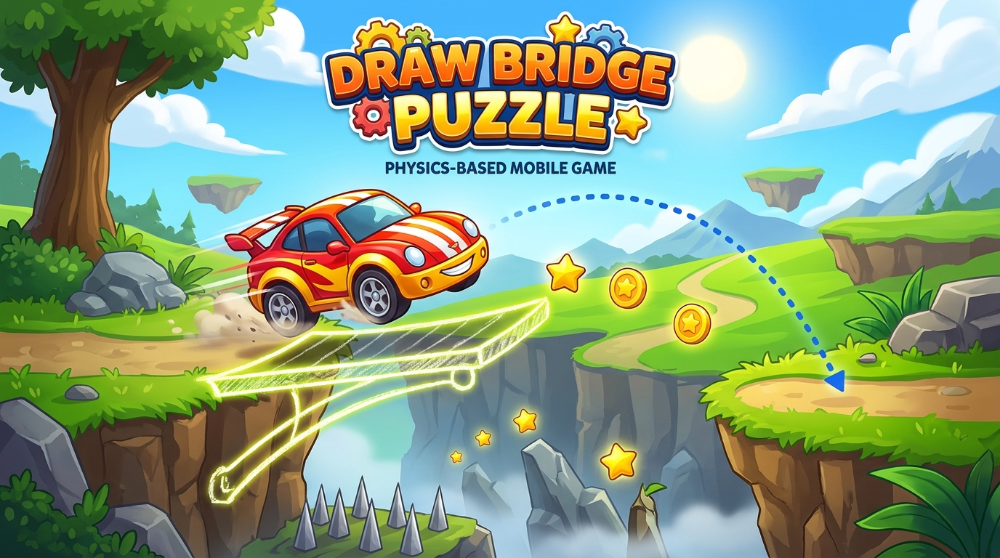

# 🌉 Draw Bridge Puzzle

<p align="center">
  
</p>

<p align="center">
  <strong>An addictive, physics-driven casual bridge-building puzzle game built with React 19, TypeScript, and Vite.</strong>
</p>

<p align="center">
  
  
  
  <a href="https://draw-bridge-puzzle.pages.dev"></a>
  
  
</p>

---

## 🎮 Overview

**Draw Bridge Puzzle** is an interactive physics puzzle game where players draw custom bridges, ramps, and pathways using a virtual pen to guide their vehicles across deadly hazards, bottomless gorges, laser gates, and spinning blades to reach the checkered victory flag.

Every stroke counts: draw bridges with structural integrity, account for vehicle momentum, gravity, wheel friction, and navigate complex kinetic obstacles.

---

## ✨ Features

### ✏️ Physics-Based Bridge Drawing
- **Real-Time Physics Simulation:** Custom 2D rigid-body and segmented wire physics engine simulating friction, gravity, wheel torque, and collision detection.
- **Dynamic Bridge Integrity:** Bridges interact with wheels, chassis, ramps, and environmental hazards with realistic suspension and deformation physics.
- **Ink / Line Restrictions:** Strategic drawing mechanics that reward optimal, resource-efficient path building.

### 🚗 Vehicle Fleet & In-Game Store
- **Vehicle Roster:** Unlock and drive distinct vehicles including **Blue Coupe**, **Sports Car**, **Delivery Truck**, **Dirt Bike**, **Army Truck**, and **Super Bike**.
- **Unique Vehicle Specs:** Each vehicle features customized mass, wheel base, acceleration torque, suspension stiffness, and ground clearance.
- **Customizable FX:** Unlockable vehicle particle trails, custom rims, and celebratory effects.

### 🧩 100 Handcrafted Puzzle Levels
- 100 progressively challenging puzzle levels out of the box.
- Dynamic environmental hazards:
  - ⚙️ **Moving platforms & Elevators**
  - 🪚 **Rotating sawblades & Spikes**
  - ⚡ **Laser barriers & Portals**
  - 🪨 **Rolling boulders & Kinetic pendulums**

### 🛠️ Built-in Level Editor
- Full visual sandbox level builder.
- Add and position spawn points, finish flags, walls, hazards, collectable cash coins, and kinetic obstacles.
- Configure hazard motion vectors, speed, and oscillation paths.
- Import, export, test-play, and manage custom user-created level JSONs directly in the browser.

### 🌐 21+ Languages (Internationalization / i18n)
- Native multi-language support:
  English (`en`), Hindi (`hi`), Spanish (`es`), French (`fr`), German (`de`), Japanese (`ja`), Korean (`ko`), Chinese Simplified (`zh-Hans`), Chinese Traditional (`zh-Hant`), Portuguese (`pt`), Italian (`it`), Russian (`ru`), Arabic (`ar`), Vietnamese (`vi`), Indonesian (`id`), Thai (`th`), Turkish (`tr`), Dutch (`nl`), Ukrainian (`uk`), Romanian (`ro`), Malay (`ms`).

### 📱 Mobile Ready & LocalStorage
- Offline-ready with browser `localStorage` persistence (`safeStorage`).
- Fully responsive canvas scaling supporting portrait, landscape, mobile touch input, and desktop mouse controls.

---

## 🚀 Getting Started

### Prerequisites

- [Node.js](https://nodejs.org/) (v18.0.0 or higher recommended)
- [npm](https://www.npmjs.com/) or [pnpm](https://pnpm.io/)

### Installation

1. **Clone the repository:**
   ```bash
   git clone https://github.com/satyamkumar420/draw-bridge-puzzle.git
   cd draw-bridge-puzzle
   ```

2. **Install dependencies:**
   ```bash
   npm install
   ```

3. **Run development server:**
   ```bash
   npm run dev
   ```
   Open [http://localhost:5173](http://localhost:5173) in your browser.

4. **Build for production:**
   ```bash
   npm run build
   ```

5. **Preview production build:**
   ```bash
   npm run preview
   ```

---

## 🕹️ Controls

| Action | Mouse | Touch (Mobile) |
|---|---|---|
| **Draw Bridge** | Left Click + Drag | Touch + Drag |
| **Clear / Redraw** | Reset Button (`R`) | On-screen Reset Button |
| **Launch Vehicle** | Play Button (`Space`) | On-screen Go Button |
| **Pan / Zoom (Editor)**| Right Click Drag / Wheel | Multi-touch Pinch / Drag |

---

## 🏗️ Project Architecture

```
draw-bridge-puzzle/
├── public/                  # Static assets (audio, vehicles, textures)
│   ├── assets/              # Coin badges, completion ribbons
│   ├── audio/               # Game SFX (engine, win, crash, click)
│   ├── vehicles/            # Vehicle bodies, wheels, and textures
│   └── banner.jpg           # Game promotional banner
├── src/
│   ├── components/
│   │   ├── common/          # Modals, buttons, HUD icons, loading screens
│   │   ├── editor/          # Level editor canvas, toolbars, property panels
│   │   ├── game/            # Game canvas, victory modal, reward overlays
│   │   └── store/           # Vehicle showroom, trail preview, smart car graphic
│   ├── config/              # Constants, vehicle specs, sky themes, pen colors
│   ├── engine/              # Physics engine (collision, bridge, vehicle propulsion)
│   ├── graphics/            # Canvas 2D renderers (car, scene, hazard motion)
│   ├── hooks/               # Custom state hooks (store, level storage, player cash)
│   ├── i18n/                # 21 localization dictionaries and context
│   ├── levels/              # 100 pre-configured JSON puzzle levels
│   ├── services/            # Audio service, YouTube Playables, safe storage
│   ├── types/               # TypeScript interfaces (level, physics, store, editor)
│   ├── utils/               # Viewport and mathematical utilities
│   ├── App.tsx              # Root application coordinator
│   └── main.tsx             # Application entry point
├── package.json
├── tsconfig.json
└── vite.config.ts
```

---

## 🛠️ Tech Stack

- **Framework:** [React 19](https://react.dev/)
- **Language:** [TypeScript 6](https://www.typescriptlang.org/)
- **Bundler:** [Vite 8](https://vitejs.dev/)
- **Icons:** [Lucide React](https://lucide.dev/)
- **FX & Animations:** Canvas Confetti, HTML5 Canvas 2D Engine
- **Linter:** [Oxlint](https://oxc.rs/)

---

## 📄 License

Distributed under the MIT License.
